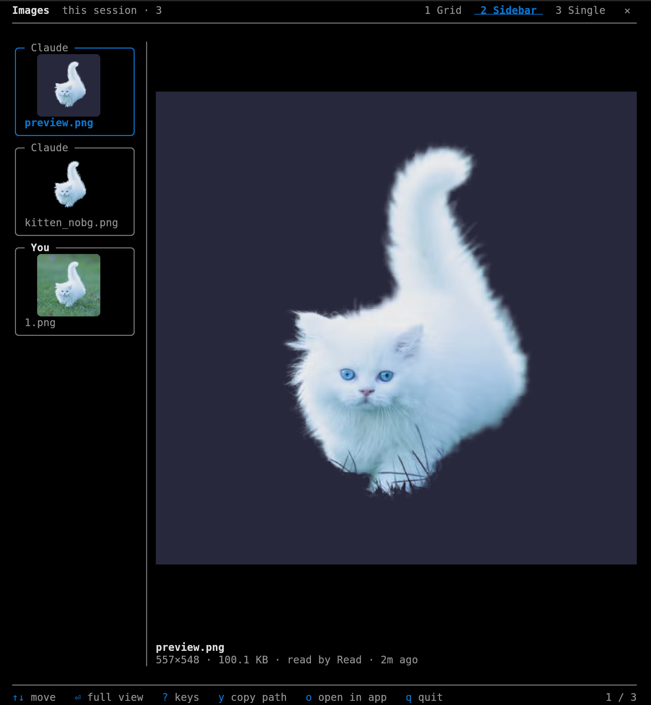

# image-log

**An image viewer for Claude Code sessions in the terminal.** Every image Claude makes, reads or receives, and every one you send it, shows up in a gallery beside your session, without a single file being copied.

<p align="center">
  
</p>

Claude saves images in many places: the project folder, a session's temp scratchpad, wherever a script writes. Some never touch disk because a tool returns them directly. image-log keeps one log of *pointers* to all of them, recording which session and agent each came from, and the viewer shows that session's images in one place, in order, tagged **You** or **Claude**.

## Install

At the prompt of a Claude Code session in a terminal:

```
/plugin install image-log --marketplace scholarstree/image-log
```

Answer `y` to add the marketplace, then pick a scope (user scope runs it in every session).

## Usage

- **It opens by itself.** When Claude makes or receives an image, the gallery opens beside Claude and shows it. Every later image appears there too.
- **`/image-log`** opens the gallery any time, for example to look back at images you sent.
- **`?`** in the gallery lists every key; `q` or the **✕** closes it.

## What it does

- **Logs, never copies.** After each tool call it appends one line per image to `~/.cache/claude-images/log.jsonl`: path, project, session, agent, tool, size and modification time. Your files stay exactly where they are.
- **Finds images from:**
  - the Write tool;
  - image paths in a Bash command or its output (only files modified during that command);
  - images Claude opens with Read (optional);
  - images you paste or drop into the prompt (optional; Claude Code keeps them in the session's temp folder, so they last until a reboot);
  - images a tool returns directly, such as screenshots, which are logged as a pointer into the session transcript.
- **Shows them** in a gallery beside Claude, leaving Claude's own window untouched (`/image-log` opens it):
  - **kitty:** a kitty split next to Claude's window;
  - **herdr:** a herdr pane next to Claude;
  - **anywhere else** (Ghostty, for example): Claude Code's own *Images* pane, docked beside the conversation.

## The gallery

Three views, switched with the tabs at the top or `1` `2` `3`:

| View | |
|---|---|
| **Grid** | cards with rounded thumbnails; click one to open it |
| **Sidebar** | a thumbnail column; the picked image large beside it |
| **Single** | one image, a **‹ Back** button, and a clickable filmstrip |

Press `?` in the gallery for every key. The most used: `y` copies the image's path (paste it into Claude), `o` opens it in your image app, `s` flips the sort order, `t` changes thumbnail size, and `[` `]` resize the sidebar. Colours come from your terminal theme.

## Platform support

| Platform | Status |
|---|---|
| Linux | supported and tested (kitty and herdr) |
| macOS | expected to work in kitty; untested. Images you paste may not be found, as macOS keeps temp files elsewhere |
| Windows, through WSL | logging works; pictures need a terminal with kitty's image protocol (WezTerm may work; Windows Terminal does not). Untested |
| Windows, native | not supported. image-log switches itself off and says so once |

## Requirements

| | |
|---|---|
| Claude Code | 2.1.296 or newer |
| Terminal | kitty or herdr for the gallery. Install kitty from [kitty's own installer](https://sw.kovidgoyal.net/kitty/binary/): distribution packages are often too old to show images. Other terminals that show pictures (Ghostty, for example) get Claude Code's own Images pane instead. |
| Gallery | `python3` with Pillow (`python3 -m pip install --user Pillow`) |
| Gallery in kitty | remote control on, in `kitty.conf`: `allow_remote_control yes` and `listen_on unix:/tmp/kitty`, then restart kitty |
| Optional | ImageMagick, to preview JPEG, WebP and other non-PNG images inside the Images pane |

### herdr and other multiplexers

Claude Code's Images pane draws pictures with kitty's Unicode placeholders, which herdr does not pass through, so inside herdr pictures cannot show in Claude's pane. Instead, image-log opens a herdr pane running its own gallery (`bin/imgview`), which draws pictures in a way herdr supports.

`CLAUDE_CODE_FORCE_TERMINAL_IMAGES=1` makes Claude Code send pictures in terminals it does not recognise, but it does not help inside herdr.

## Settings

Open them under this plugin in `/config`:

| Setting | Default | |
|---|---|---|
| Open the gallery automatically | `claude` | `claude`: when Claude makes or receives an image; `any`: on any new image, yours too; `never`: only with `/image-log`. An open gallery shows every new image either way. |
| Log images Claude reads | on | also log image files Claude opens with Read |
| Log images you send | on | also log images you paste or drop into the prompt |
| Gallery beside Claude | on | in herdr or kitty, show the gallery next to Claude instead of Claude's own Images pane |

## Housekeeping

image-log never deletes or moves your images. Its own cache in `~/.cache/claude-images/` is kept small:

- previews (`render/`) and thumbnails (`thumbs/`) are kept for 30 days, at most 1,000 files each;
- the log is cut back to its newest 10,000 lines once it passes 20,000.

If an image file is deleted or overwritten later, the gallery hides it or marks it as changed.

## Privacy

Everything stays on your machine. The log is a local file of paths and session ids; image-log uploads nothing and calls no network service.

## Uninstall

```
/plugin uninstall image-log
```

To remove its log and caches as well, delete `~/.cache/claude-images/`. Your images are not affected.

## Limitations

- Only images from tool calls made while the mod is installed are logged. Sessions from before that, and the start of a forked session (which gets a new session id), have an empty gallery. A resumed session keeps its id, so it shows what was logged before.
- Images that only existed in `/tmp` (session scratchpads, and the copies Claude Code keeps of images you send) disappear on reboot. Images a tool returned directly last as long as the session transcript, which Claude Code deletes after about 30 days.
- File paths containing spaces are not picked up from Bash commands.

## Development

The gallery (`bin/imgview`) sends pictures afresh on each redraw: kitty and herdr both drop stored pictures when their placements are cleared, so keeping pictures in the terminal is not reliable. Thumbnails are cached in memory and in `~/.cache/claude-images/thumbs/`, so only the sending repeats. `IMGVIEW_DEBUG=<file>` logs each redraw and the terminal's replies.

```
claude --plugin-dir .                 # run a session with the mod from this folder
claude plugin validate .              # check the manifest and hooks
claude plugin test .                  # hook helper tests
python3 -m unittest discover -s tests # gallery tests
```

## License

MIT
